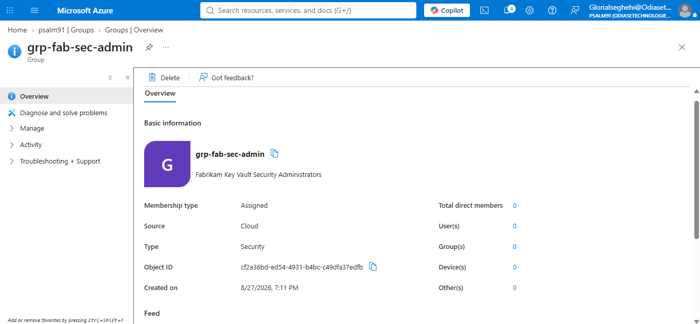
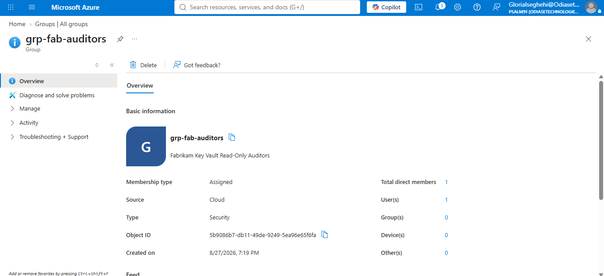
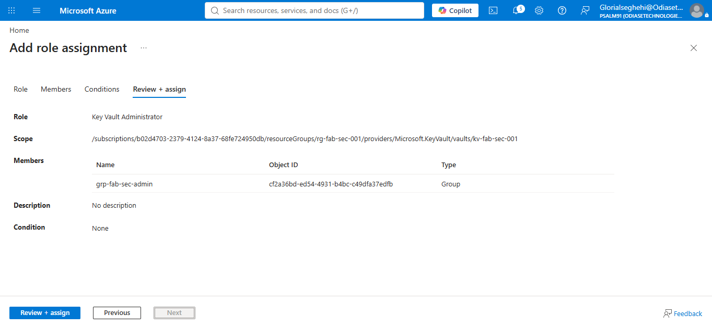
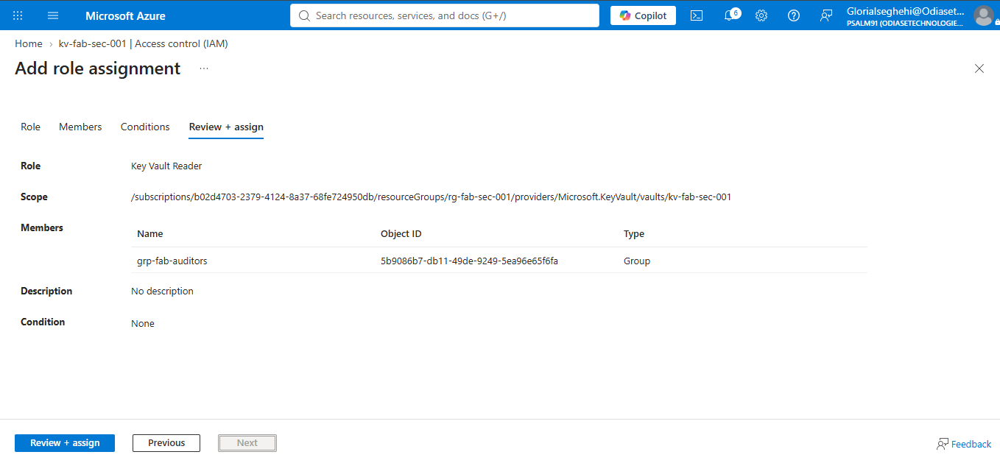
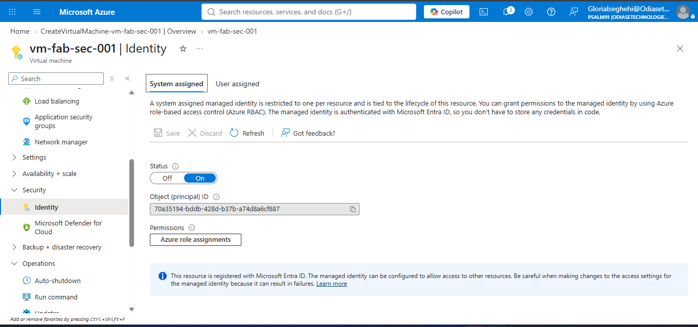
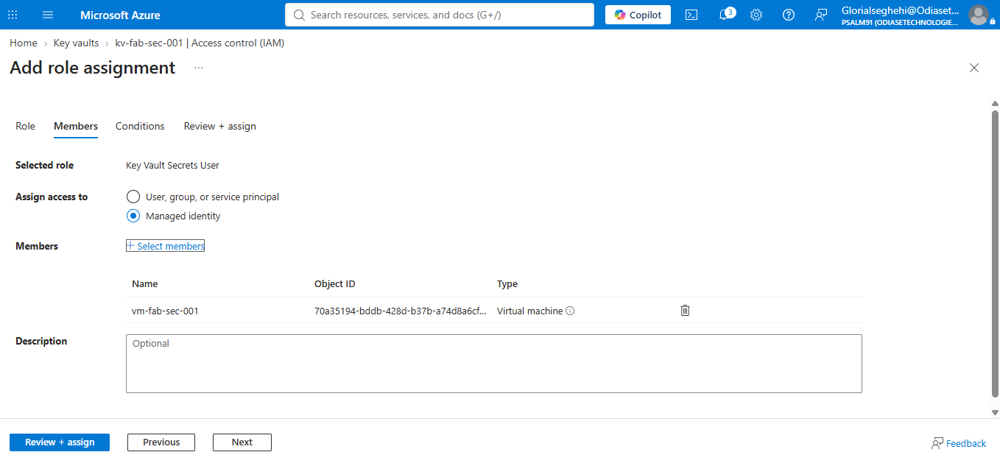
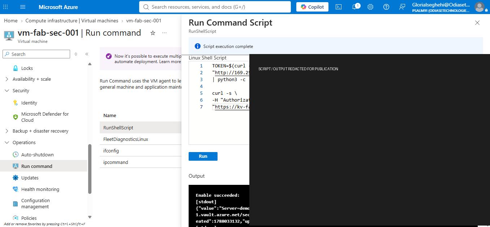

# Fabrikam Financial Services : Project Brief and Identity & Access Management

## Project brief

**Enterprise Azure Security Governance & Key Vault Implementation**

- **Client:** Fabrikam Financial Services
- **Engagement reference:** FAB-SEC-001
- **Role:** Cloud Security Engineer
- **Project type:** SC-500 capstone

### 1. Background

Fabrikam Financial Services is moving important workloads to Azure. At the moment, application secrets, encryption keys, and TLS certificates are stored in different places, including configuration files, developer laptops, and a shared password spreadsheet.

The client has also had several security problems:

- A database connection string was committed to a source-code repository in plain text.
- A contractor kept Owner access to production resources for three months after leaving.
- A storage account was left open to public access for two weeks before anyone noticed. There was no policy in place to block that setup.
- The security team could not easily check who accessed a secret or when it happened.

The client wants to improve how it stores secrets, controls access, prevents unsafe configurations, and reviews security activity. This portfolio records the Azure lab work I completed for that scenario. It is a lab implementation, not a claim that changes were made in a real Fabrikam production environment.

### 2. Client requirements

| Ref | What the client needs | Azure service or feature |
|---|---|---|
| R1 | Keep application secrets, keys, and certificates in one secure place. | Azure Key Vault with RBAC, soft delete, and purge protection |
| R2 | Give people only the access they need, and make access easier to manage when people join or leave. | Microsoft Entra groups and Azure RBAC |
| R3 | Avoid storing passwords or credentials in application code and settings. | Managed identity |
| R4 | Block unsafe resource settings before they are used. | Azure Policy with the Deny effect |
| R5 | See the security state of the environment and identify risks. | Microsoft Defender for Cloud and Secure Score |
| R6 | Keep records of access to secrets, keys, and certificates. | Azure Monitor diagnostic settings and Log Analytics |
| R7 | Review the environment against relevant compliance standards. | Defender for Cloud Regulatory Compliance |
| R8 | Get notified about selected security events. | Azure Monitor alerts and action groups |
| R9 | Provide clear evidence of what was configured and what still needs testing. | Implementation report and executive summary |

### 3. Project constraints

- Key Vault uses Azure RBAC, not the older access-policy permission model.
- The design covers three types of access: a security administrator, a workload using managed identity, and a read-only auditor.
- Real passwords and customer secrets must not be included in code, scripts, configuration files, or policy definitions.
- Tests use lab identities and dummy values.
- The work should be repeatable. Where possible, the documentation should include the CLI or PowerShell steps that match the portal setup.

### How this documentation is organised

I split the project into three parts so the setup and decisions are easier to follow:

1. **Identity and access management** : the Entra groups, role assignments, and VM managed identity.
2. **Azure resources, networking, and RBAC** : the resource group, Key Vault, VM, virtual network, subnets, private endpoint, and private DNS.
3. **Monitoring, governance, and handover** : Azure Policy, Defender for Cloud, logs, alerts, compliance evidence, and outstanding work.

---

# 1. Identity and Access Management

## What I was trying to fix

The client brief described two main problems: secrets were stored in too many places, and a former contractor kept high-level access after leaving. I needed to show how access could be separated by role and how a workload could access a secret without storing a password in its code.

I used Microsoft Entra ID for people and groups, and a system-assigned managed identity for the virtual machine. Azure RBAC controls what each identity can do in Key Vault.

## Step 1: Create the security groups in Microsoft Entra ID

I created two assigned security groups:

- `grp-fab-sec-admin` — **Fabrikam Key Vault Security Administrators**
- `grp-fab-auditors` — **Fabrikam Key Vault Read-Only Auditors**

Using groups means I can manage access through group membership instead of assigning the same role to each person one by one. The role can stay on the group when its membership changes.

*Evidence: `grp-fab-sec-admin.png`. This shows the security-administrator group and its display name. It does not show who belongs to the group or prove that an access test passed.*

*Evidence: `grp-fab-auditors.png`. This shows the separate auditor group. Keeping auditors separate from administrators helps avoid giving reviewers more access than they need.*

## Step 2: Give the security administrator group access to manage the vault

I assigned the **Key Vault Administrator** role to `grp-fab-sec-admin` at the scope of `kv-fab-sec-001`. I used the vault scope rather than assigning the role across the whole subscription.

*Evidence: `roleassignment-sec-admin-rbac.png`. This records the role assignment shown in the portal. Key Vault Administrator is a powerful role, so membership should be limited and reviewed regularly. In a production setup, I would also check whether some admin tasks could use narrower roles.*

**Why I did this:** The group gives the team one place to manage who can administer this vault. Assigning the role at the vault scope also limits where that assignment applies.

## Step 3: Give auditors read-only access to vault information

I assigned **Key Vault Reader** to `grp-fab-auditors` at the scope of `kv-fab-sec-001`.

*Evidence: `roleassignment-auditor-vaultreader.png`. This shows the Key Vault Reader role assigned to the auditor group at the vault scope.*

Key Vault Reader lets a user view information about the vault and its settings. It does not give them permission to read secret values, key material, or certificate contents. That lets an auditor review the setup without automatically being able to access the protected data.

**Test still needed:** This screenshot shows the role assignment, but it does not prove that secret access is denied. To finish the test, I should sign in as a test auditor, confirm that the vault information is visible, and then show that an attempt to read a secret value is denied.

## Step 4: Enable a system-assigned managed identity on the VM

I created `vm-fab-sec-001` and enabled its system-assigned managed identity. Azure manages this identity and uses Microsoft Entra ID to authenticate it. The VM can use the identity to request access to Azure services without keeping an application password or client secret in a script.

*Evidence: `VM-SYSTEM-ASSIGNED-DEPLOYED.png`. This shows the VM's Identity page with the system-assigned identity enabled.*

## Step 5: Give the VM the permission it needs to read a secret

For the secret retrieval test, I assigned **Key Vault Secrets User** to the managed identity of `vm-fab-sec-001` at the Key Vault scope.

*Evidence: `vm-manage-identity-assignment-secret-user.png`. This shows the VM managed identity and the Key Vault Secrets User role.*

Key Vault Secrets User is the role that fits the task of reading secret values. Secrets Officer can manage secrets, while Key Vault Administrator can manage a wider range of vault operations. Those broader permissions are not needed just to read a secret.

The project also includes `run-command-test-successful.png` and `key-vault-retrieved-secerts.png` from the VM-side test. I covered the script and output area in the second screenshot before using it in this document because the original showed a dummy connection-string value. Even dummy values should not be published unnecessarily.

*Evidence: The script/output area has been covered for publication. This redacted screenshot records the test attempt, but it does not show the returned secret value.*

## Step 6: Record the temporary role assignments used during troubleshooting

While troubleshooting, I temporarily assigned extra Key Vault roles to the VM as I tested key and certificate operations. The supplied screenshots include:

- `key Vault Crypto Officer to create keys.png`
- `Key Vault Secrets Officer-assigned-to-vm.png`
- `keyvault-cert-officer-vm-assigned.png`
- `removed-Key Vault Crypto Officer.png`

I later removed the temporary Crypto Officer assignment shown in the removal screenshot. These extra assignments were part of troubleshooting; they are not the permissions I intend the workload to keep. A workload that only needs to read a secret should not have permission to manage keys or certificates.

**What I learned:** Network access and permissions are two separate checks. A private endpoint or DNS problem can stop the VM or my browser from reaching Key Vault, even if the RBAC role is correct. On the other hand, being able to reach the vault does not mean the caller has permission to read a secret or manage a key. Giving the VM broader roles will not fix a network or DNS problem.

**Evidence note:** The removal screenshot documents the Crypto Officer assignment being removed. It does not, on its own, prove that every temporary role was removed. To confirm the final state, I should review the current role assignments on `kv-fab-sec-001` and check that the other temporary roles are no longer present.

## The difference between identity, authentication, and permissions

- **Microsoft Entra ID** identifies the user, group, or workload making the request.
- **Managed identity** lets the VM authenticate to Azure without storing a password in its code.
- **Azure RBAC** controls which actions that identity can perform and the scope where it can perform them.
- **Key Vault** checks the identity's permissions and whether the network connection is allowed.

## Evidence and remaining checks

| Check | What the screenshots show | What I still need to verify |
|---|---|---|
| Admin group and vault role | The group and its Key Vault Administrator assignment | Review group membership and confirm the role is still assigned at vault scope |
| Auditor role | Key Vault Reader assigned to the auditor group | Test that vault information is visible but secret-value access is denied |
| VM managed identity | The VM Identity page | Confirm the test uses the managed identity and does not rely on a stored credential |
| Secret retrieval | VM Run Command and retrieval-test screenshots | Keep sanitized test output and match it to a Key Vault audit event |
| Temporary role cleanup | A screenshot showing the Crypto Officer assignment was removed | Check current role assignments to confirm the other temporary roles are also gone |
