# 2. Azure Resources, Private Networking and RBAC

## Why I arranged the resources this way

The project needed more than a place to store secrets. I also needed to control how the vault could be reached, who could manage it, and how a workload could connect without making the vault publicly available.

I put the lab resources in `rg-fab-sec-001` so they would be together and easier to review. The resource group screenshot gives a quick view of what I deployed, including the Key Vault, VM, private endpoint, private DNS zone, Log Analytics workspace, and alert resources. It is an inventory of the lab, not proof that every component passed its own test.

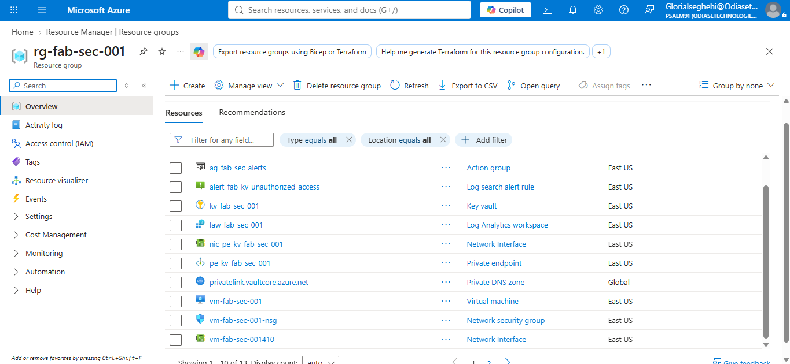

*Evidence: `resource-group-with all resources.png`. It shows `rg-fab-sec-001` and resources including `kv-fab-sec-001`, `vm-fab-sec-001`, `pe-kv-fab-sec-001`, `privatelink.vaultcore.azure.net`, `law-fab-sec-001`, `ag-fab-sec-alerts`, and `alert-fab-kv-unauthorized-access`.*

## Architecture

*Architecture diagram for the Fabrikam Azure security lab.*

## Step 1: Create the resource group

I created `rg-fab-sec-001` in **East US**. It gives the lab resources one place to manage and makes it easier to review, tag, monitor, and clean up the environment.

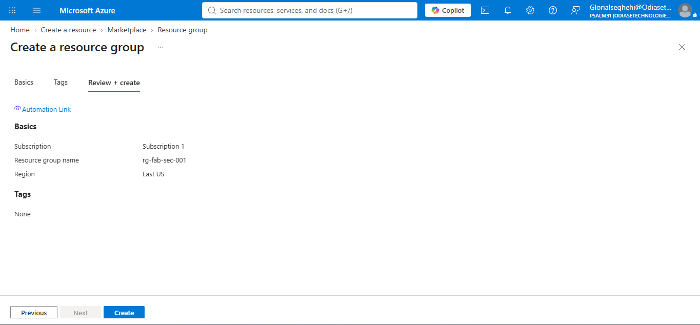

*Evidence: `Resource-group1.png`. It shows the resource group name and region during setup. The resource group helps organise the lab; the security controls come from how the individual resources are configured.*

## Step 2: Create and configure Key Vault

I created the vault `kv-fab-sec-001` and selected **Azure role-based access control (RBAC)** as its permission model instead of the older access-policy model. I also enabled soft delete and purge protection.

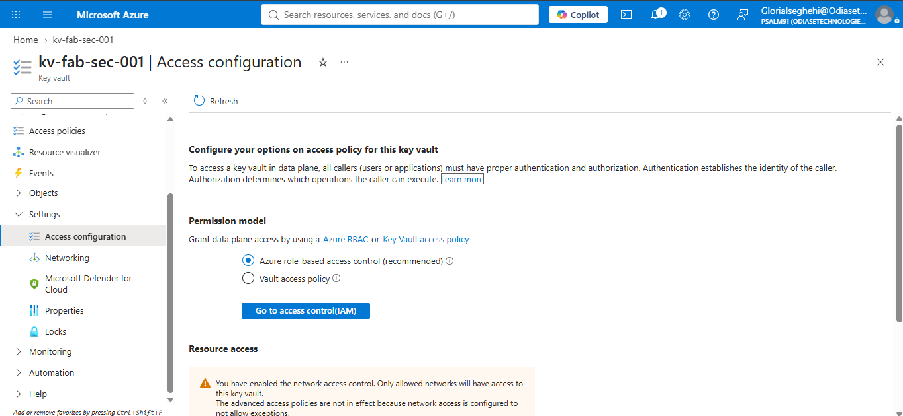

*Evidence: `E01_KeyVault_RBAC_Mode.png`. It shows Azure RBAC selected as the vault's permission model.*

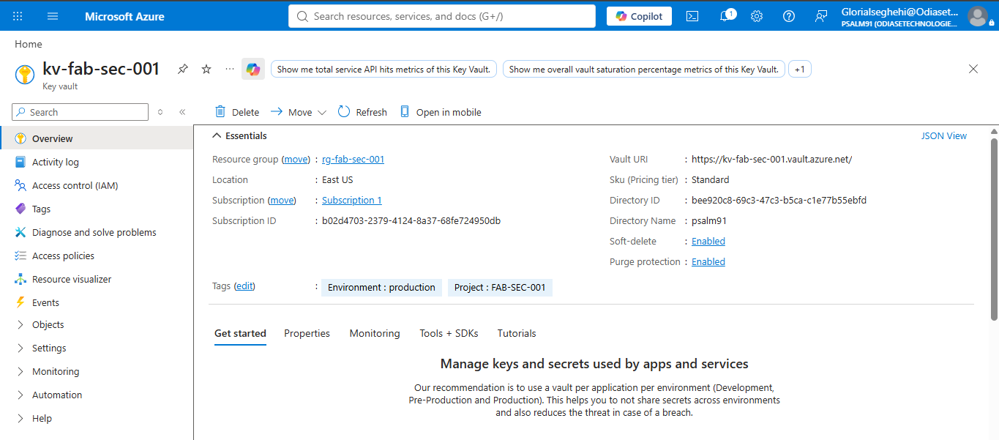

*Evidence: `E02_KeyVault_Recovery_Protection.png`. It shows soft delete and purge protection enabled. These settings help recover deleted items and make it harder to permanently purge them during the protection period.*

I also added project and environment tags. They are visible in `kv-fab-sec-001-keyvault-propeties.png` and `KeyVaults-tag.png`. Tags help identify a resource's purpose, but they do not replace access controls or other security settings.

## Step 3: Add a private endpoint to Key Vault

I created `pe-kv-fab-sec-001` and its network interface, `nic-pe-kv-fab-sec-001`. The endpoint is connected to `vnet-fab-sec-001` through the `snet-pe-001` subnet. The screenshots show that the endpoint deployment completed and that a private IP address was assigned.

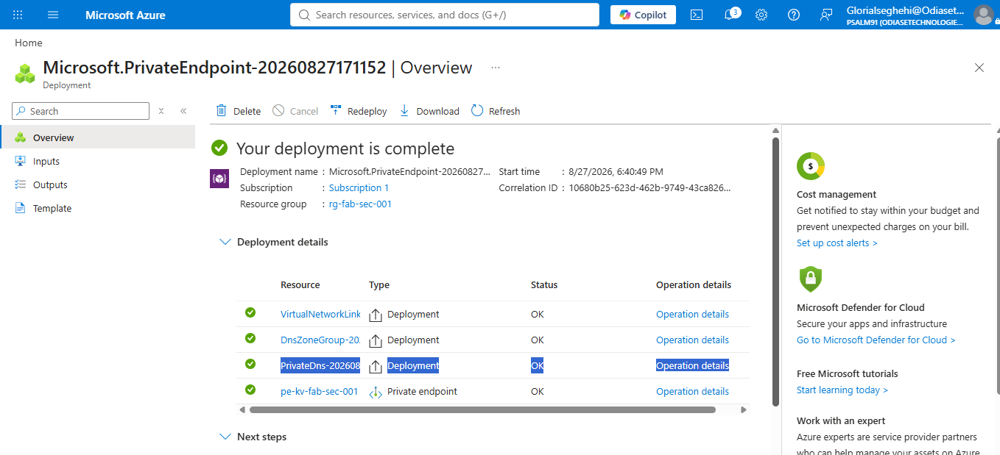

*Evidence: `private-endpoint-deployed-overview.png`. It shows the private endpoint deployment completed. The private endpoint was deployed successfully, but I still needed to check that DNS was resolving correctly and that the VM could connect to Key Vault through the private network.*

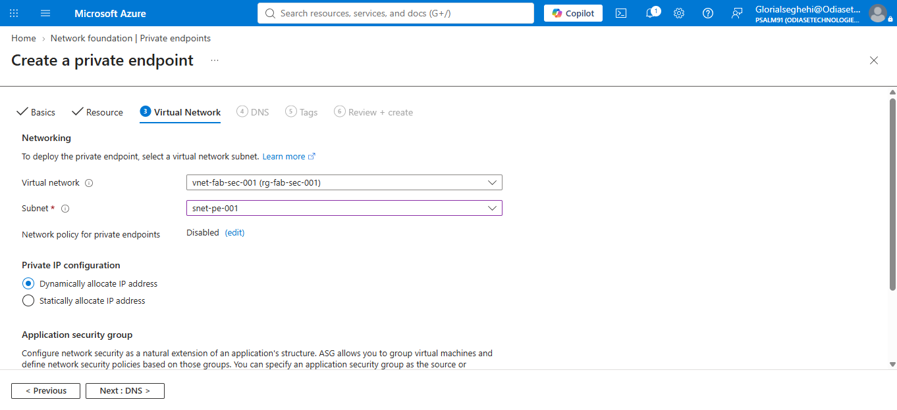

*Evidence: `Private-Endpoint-Network-tab.png`. It shows `vnet-fab-sec-001` and `snet-pe-001` selected for the endpoint.*

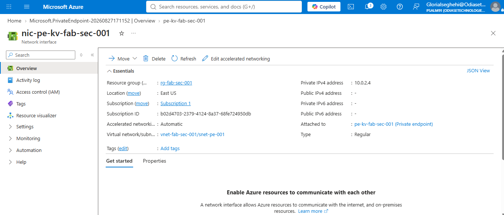

*Evidence: `E06_Private_Endpoint_IP.png`. It shows the endpoint's network interface and private IP address. 
The private endpoint was created successfully, and the Key Vault was assigned a private IP address within the virtual network.*

### Why I used a private endpoint

A private endpoint gives Key Vault a private entry point through the virtual network. This reduces reliance on public network access. A client still needs to be on a network that can reach the endpoint, and DNS must resolve the vault hostname to the private address.

## Step 4: Configure private DNS

I used the private DNS zone `privatelink.vaultcore.azure.net` and linked it to the private endpoint through its DNS zone group. The screenshots show the DNS integration and the vault hostname configuration.

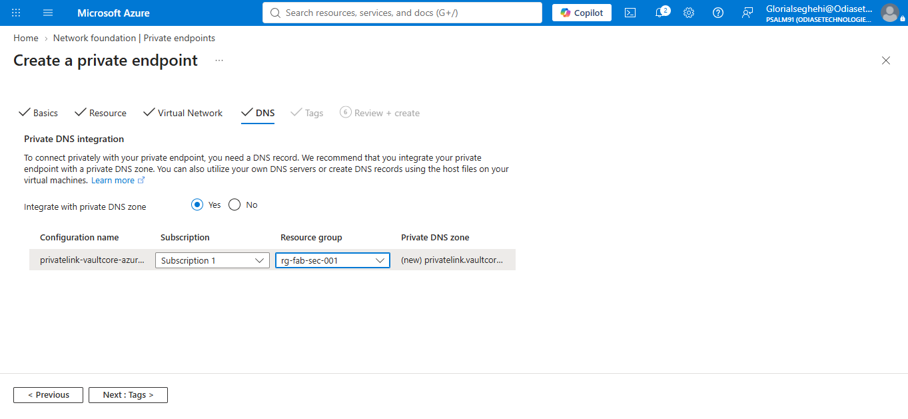

*Evidence: `Private-DNS-Tab.png`. It shows the private DNS integration selected during endpoint setup.*

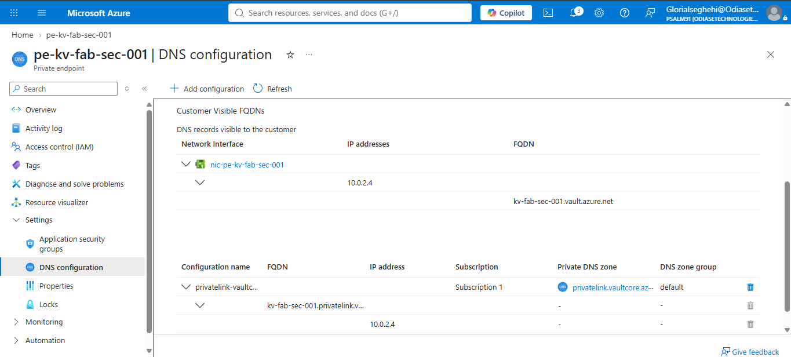

*Evidence: `E07_Private_DNS_Configuration.png`. It shows the private DNS zone association and the vault hostname configuration. This is part of the setup needed for the normal Key Vault hostname to resolve to the private endpoint from the intended network.*

## Step 5: Use a VM to test the workload access

I created `vm-fab-sec-001` with Ubuntu 24.04 and connected it to `vnet-fab-sec-001` through `snet-app-001`. I used the VM to test managed-identity authentication and requests to Key Vault.

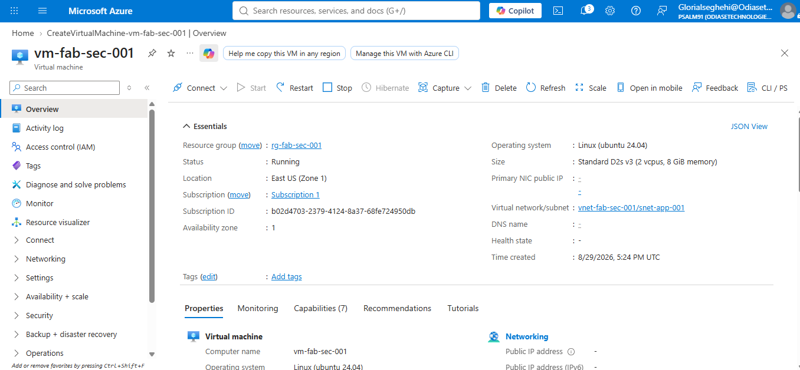

*Evidence: `vm-created_overview1.png`. It documents the VM and its placement in `snet-app-001`.*

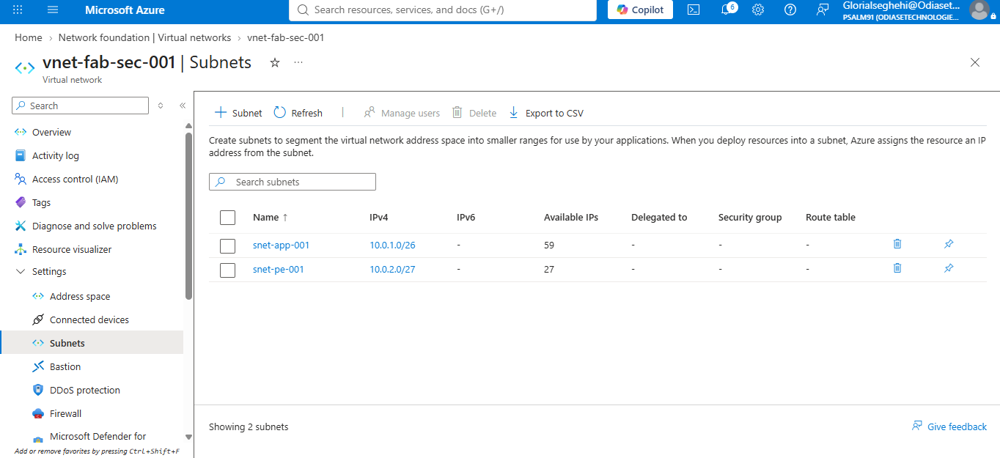

*Evidence: `virtual-Network-seg.png`. It shows the two subnets: `snet-app-001` (`10.0.1.0/26`) and `snet-pe-001` (`10.0.2.0/27`). Keeping the workload and private endpoint in separate subnets makes their roles in the network easier to see and manage.*

The project also includes `NSG-VM.png` and `vm-networking-deployed.png`, which show the VM's network security and network setup. 

## Step 6: Follow the request from the VM to Key Vault

For the secret retrieval test, the steps are:

1. The test runs on `vm-fab-sec-001`.
2. The VM uses its system-assigned managed identity to get an access token from Microsoft Entra ID.
3. The request uses the Key Vault hostname. Private DNS needs to resolve it to the private endpoint address from the intended network.
4. Key Vault checks the identity's RBAC permissions. The intended role for reading a secret is **Key Vault Secrets User**, assigned at the vault scope.
5. Key Vault diagnostic logs records the request.

The network path and RBAC permissions must both be correct. During troubleshooting, I temporarily assigned Key Vault Crypto Officer, Secrets Officer, and Certificate Officer roles to the VM while testing key and certificate operations. I later removed the Crypto Officer assignment shown in the removal screenshot. These extra roles were not needed for the final secret-reading task.

The main lesson was that adding an RBAC role will not fix a DNS or network problem. I needed to check both connectivity to the vault and the permissions assigned to the managed identity.

## Azure Policy for public access

I assigned a policy named `FAB-SEC-001-Deny-Public-KeyVault` to block Key Vault configurations that allow public network access. The project also includes `FAB-deny-storage-public-access` and the `FAB-SEC-001-Deny-Mandatory-Tags` initiative. I cover these governance controls in Section 3.

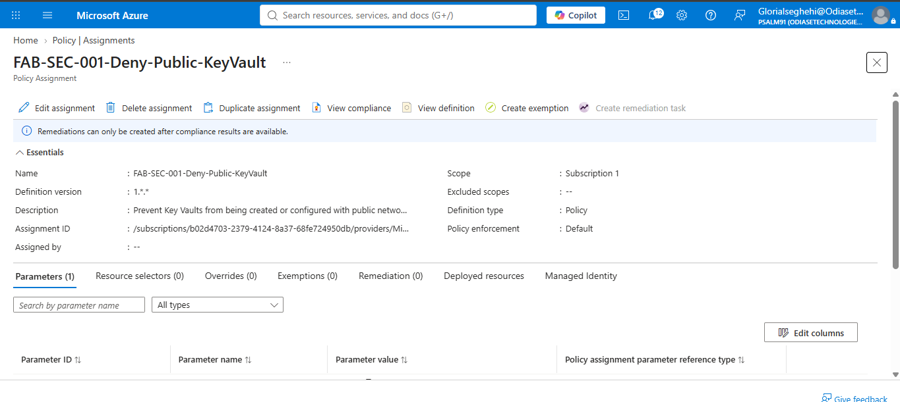

*Evidence: `deny-pub-kv-created-policy.png`. It shows the policy assignment and its scope. To demonstrate that the policy blocks an unsafe configuration.*

## Why I switched from App Service to a VM

I initially tried to use App Service for the workload. However, I could not complete the App Service deployment in East US because I ran into quota limits. I was not able to get the quota increased, so I switched to `vm-fab-sec-001` and used it to continue testing managed identity and Key Vault access.

The folder includes screenshots from my App Service plan, Web App, and VNet integration attempts. These show that I explored that option. The VM is the workload environment used for the tests documented in this project.

## Evidence and remaining checks

| Check | Evidence | What it shows or what remains |
|---|---|---|
| Resource group | `Resource-group1.png` and resource inventory | The lab resources and region are documented. |
| Key Vault uses Azure RBAC | `E01_KeyVault_RBAC_Mode.png` | The permission model is shown as Azure RBAC. |
| Soft delete and purge protection | `E02_KeyVault_Recovery_Protection.png` | Both settings are shown enabled. |
| Private endpoint | `private-endpoint-deployed-overview.png` and `E06_Private_Endpoint_IP.png` | Deployment and private IP are shown; test connectivity from the VM. |
| Private DNS | `Private-DNS-Tab.png` and `E07_Private_DNS_Configuration.png` | DNS integration is shown; test hostname resolution from the VM. |
| VM workload test | VM, identity, and Run Command screenshots | The VM test path is documented; keep secret values out of public screenshots. |
| Public access policy | Policy assignment screenshot | The assignment is shown; retain a separate example of a deployment being denied. |
| Temporary role cleanup | `removed-Key Vault Crypto Officer.png` | The Crypto Officer removal is documented; check current assignments to confirm other temporary roles are also gone. |
| App Service attempt | App Service and VNet integration screenshots | These document the attempt, not a successful deployment. |
