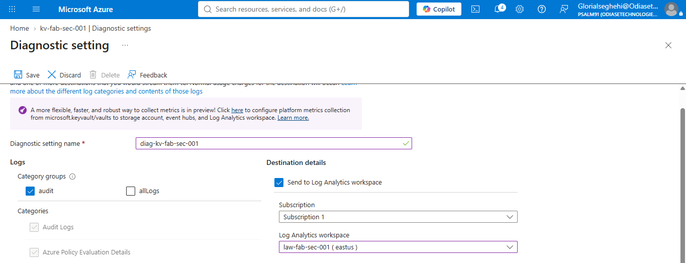
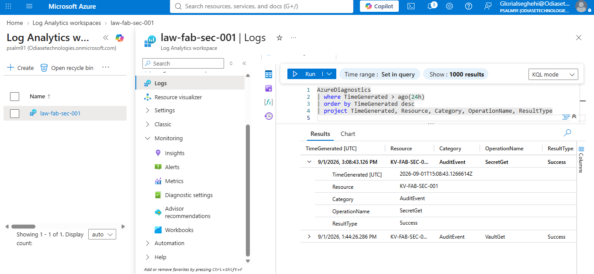
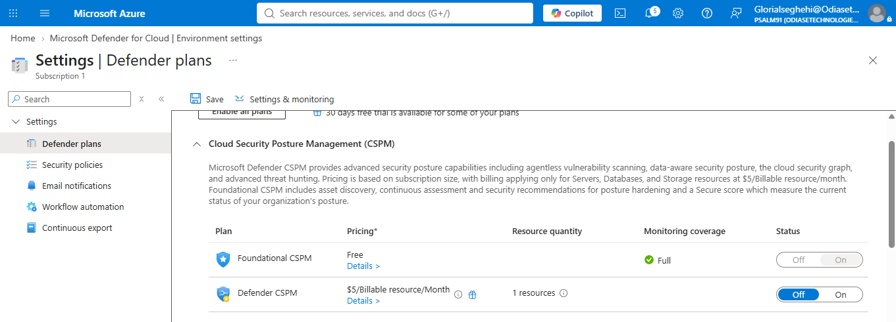
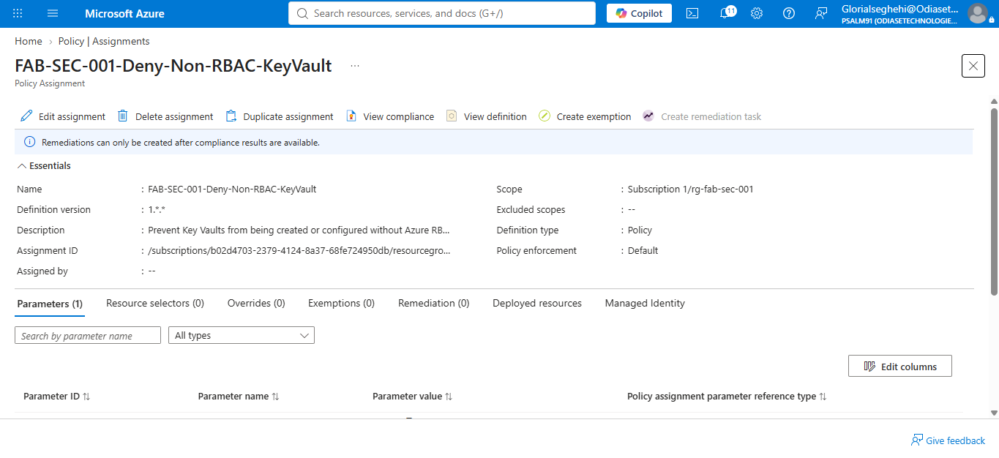
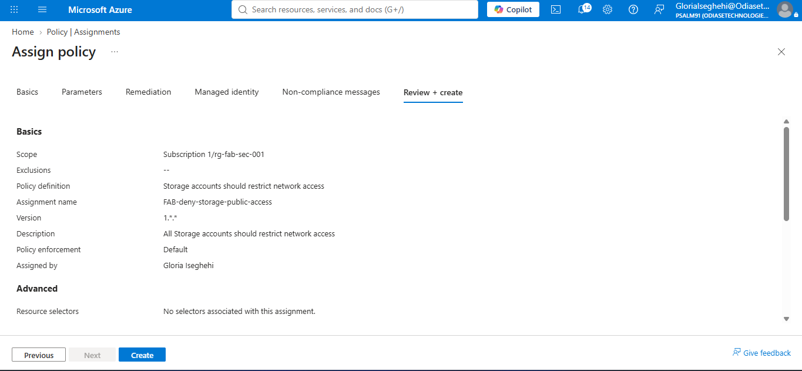
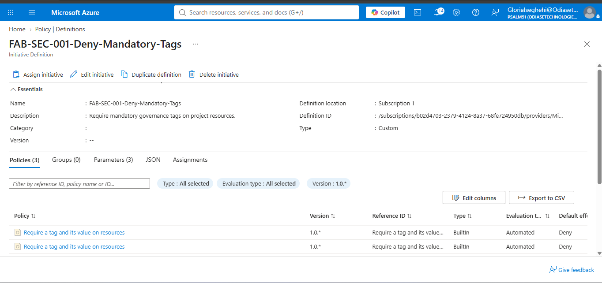
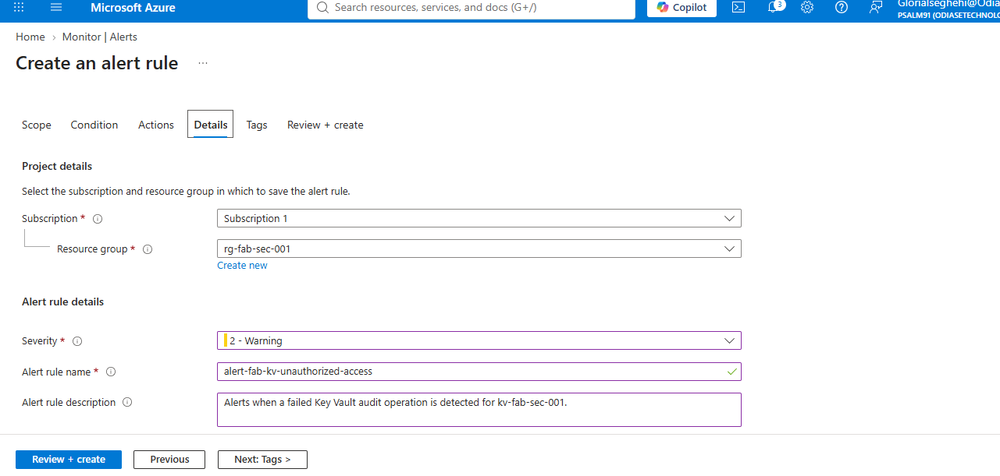
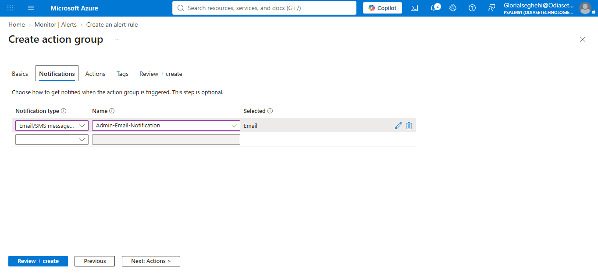
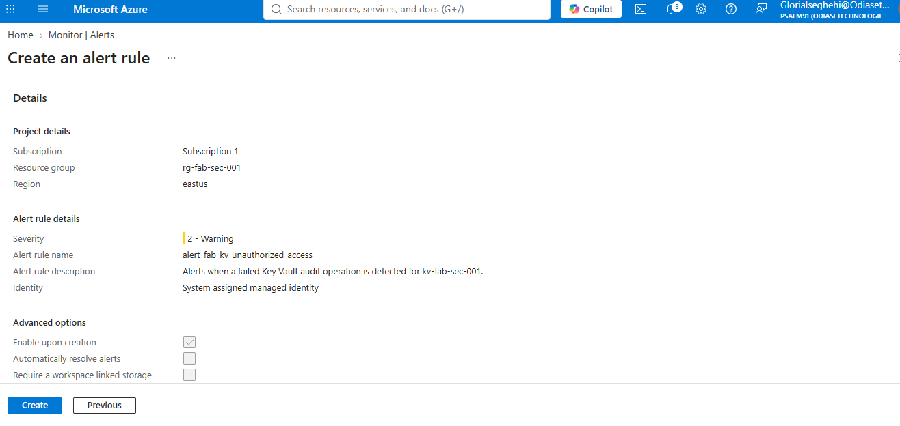

# 3. Monitoring, Governance, Compliance and Handover

## What I needed to monitor

After setting up Key Vault and access controls, I needed a way to review secret access, apply security rules across the environment, and alert the team when a relevant failure occurred. This section covers the monitoring and governance controls configured for the Fabrikam lab, along with the evidence available for each one.

## Step 1 : Send Key Vault logs to Log Analytics

I created the Log Analytics workspace `law-fab-sec-001` and configured the Key Vault diagnostic settings to send audit logs to it.



*Key Vault diagnostic settings showing Log Analytics as the destination.*



*Log Analytics results showing a successful `SecretGet` audit event.*

The query results include a Key Vault `AuditEvent` with the operation `SecretGet` and result `Success`. This confirms that a secret-read event reached Log Analytics and could be reviewed. The `keyvault-log-analytics-2.png` screenshot also shows `SecretGet` and `VaultGet` events.

The query used to review recent events was:

```kusto
AzureDiagnostics
| where TimeGenerated > ago(24h)
| order by TimeGenerated desc
| project TimeGenerated, Resource, Category, OperationName, ResultType
```

This query shows the operation performed and its result, but I also need to know who performed it when investigating an access issue. I would update the query to include the caller information available in Log Analytics and filter the results to the relevant Key Vault or operation. Since the caller field can vary depending on the diagnostic table, I would first check the available columns in the workspace.

## Step 2 : Review security posture in Defender for Cloud

I reviewed the Defender for Cloud settings for Foundational Cloud Security Posture Management (CSPM) and the Key Vault protection plan.



*Defender for Cloud Foundational CSPM settings.*


*Key Vault protection plan settings in Defender for Cloud.*

### Microsoft Defender for Cloud : Foundational CSPM & Protection Plan Settings

 **Note on Plan Configuration:** Advanced protection plans (such as Key Vault and Resource Manager protections) incur monthly per-resource or subscription fees[cite: 1], which is why they were kept disabled for this lab environment. Even so, reviewing the Defender for Cloud dashboard is essential for demonstrating how organizations centralize security recommendations, track compliance, and monitor overall cloud posture from a single pane of glass.

## Step 3 : Configure Azure Policy guardrails

I configured policy guardrails for the following areas:

- `FAB-SEC-001-Deny-Public-KeyVault` : intended to deny Key Vault configurations that allow public network access.
- `FAB-deny-storage-public-access` : intended to restrict public network access for storage accounts.
- `FAB-SEC-001-Deny-Non-RBAC-KeyVault` : intended to require Azure RBAC for Key Vault authorization.
- `FAB-SEC-001-Deny-Mandatory-Tags` : initiative for the required resource tags.



*Azure Policy assignment for Key Vault RBAC.*



*Azure Policy assignment for storage network access.*



*Mandatory-tags initiative and its configured effects.*

**Validation Note:** While these screenshots show the policy assignments successfully applied, they don't capture an actual blocked deployment in action. To fully prove enforcement, a test deployment that violates the rule (along with the resulting Azure Policy denial message) should be included in the evidence set.

## Step 4 : Configure a Key Vault alert

I created the alert rule `alert-fab-kv-unauthorized-access` for failed Key Vault audit operations involving `kv-fab-sec-001`. The action group is `ag-fab-sec-alerts`, with an email action named `Admin-Email-Notification`.



*Alert rule details for failed Key Vault audit operations.*



*Email notification action configured in the alert action group.*



*Alert rule configuration at the review stage.*

The screenshots document the alert configuration. They do not show that the rule fired or that an email was received. To verify the full alert path, a controlled test needs to generate an event that matches the rule, followed by evidence of the fired alert and the notification received. The test should use a test identity and avoid real secrets or production accounts.

## Step 5 : Regulatory compliance

 I kept the focus here on core Azure Policy assignments. While I didn't map a full regulatory framework (like CIS or the Azure Security Benchmark) due to lab scope, in a real production setup I’d enable the Regulatory Compliance dashboard in Defender for Cloud to actively track passed, failed, and unassessed controls right from the portal.

## Step 6 : Handover and next steps

The controls provide a starting point for managing access to secrets, reviewing audit events and applying governance rules. 

- **Risk addressed:** Key Vault provides a central place for secrets; access is assigned through identities and groups; policy guardrails are configured; and Key Vault audit events can be reviewed in Log Analytics.
- **Items that still need attention:** review role assignments regularly, test private DNS and network connectivity from each workload, confirm Defender for Cloud settings, and make sure alerts have an owner who can respond.
- **Next steps:** test the policy denial rules, verify the auditor's access is limited as intended, record the actual Secure Score and compliance results, test alert delivery, and document repeatable CLI or PowerShell commands.

The client brief also calls for these handover deliverables:

1. Design decisions for requirements R1–R9, including one rejected alternative for each.
2. A numbered evidence pack mapped to the acceptance criteria.
3. CLI or PowerShell equivalents for the configured controls, with secrets excluded.
4. A one-page executive summary written for a business audience.
5. A README covering onboarding, secret rotation and alert response.

  These screenshots serve as supporting evidence for the deployment. The full architectural decisions, scripts, executive summary, and operational guidelines are detailed across the main documentation files in this repository.
## Acceptance status

| Requirement | Evidence available | Status |
|---|---|---|
| R5 — Defender for Cloud and Secure Score | CSPM settings and Key Vault plan screenshots | Settings pages are documented. Record the actual Secure Score and confirm the plan's final status. |
| R6 — Secret access logging | Log Analytics query showing `SecretGet` / `Success` | A successful secret-read event is shown. Include caller identity in the query results if the available schema supports it. |
| R7 — Regulatory compliance | No conclusive compliance dashboard evidence in this set | Capture the dashboard and record the standard and control results reviewed. |
| R8 — Alerting | Alert rule and email action configuration | Configuration is documented. Capture a fired alert and the received notification to verify delivery. |
| R9 — Handover | Architecture diagram and implementation screenshots | Complete the design matrix, scripts, technical report, executive summary and operational README. |
